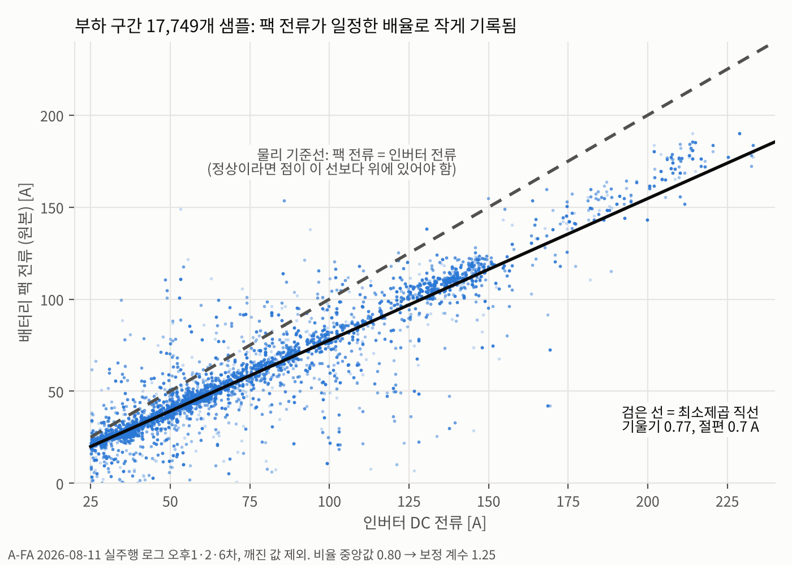

# afa-telemetry-sql — 실주행 로그 SQL 분석 + AI 분석 자동화

학생 포뮬러 전기차 팀 A-FA의 실주행 로그(2026-08-11, 세션 10개, 198,027행)를 SQLite로 옮겨
**① 예전 Python 분석을 SQL로 재현**하고, **② 새 로그가 들어오면 품질 검사·보고서까지 자동으로** 돌게 하고,
**③ 말로 물으면 AI가 SQL을 짜 답하되, 그 AI가 얼마나 맞는지 정답 셋으로 채점**한 프로젝트입니다.

SQL을 제대로 익히려고 시작했고, 예제 데이터 대신 직접 만든 계측 시스템([afa2026](https://github.com/tkddn647-ship-it/afa2026))으로 모은 실측 데이터를 썼습니다.
원본 로그(`data/`, `inbox/`)는 팀 데이터라 레포에 올리지 않았습니다.

| 숫자 | 뜻 |
|--|--|
| **0.801 · 0.795 · 0.796** | 부하 구간 팩/인버터 전류 비율 중앙값. 예전 Python 결과를 SQL로 그대로 재현 (pandas 교차검증 15항목 일치) |
| **기울기 0.77, 절편 ≈ 0 A** | 오프셋이 아니라 배율 오류라는 판단을 최소제곱 직선으로 뒷받침 |
| **10개 세션 자동 처리 5.6초** | 파일 해시로 중복을 건너뛰고, 품질 경고 규칙 4개로 세션 보고서 생성 |
| **AI SQL 정답률 9/17 → 17/17** | 개발용 17문항. 분석 규칙(정의서)을 두 번 고쳐 줌 |
| **처음 보는 문항 3/8 → 7/8** | 규칙 확정 뒤 한 번만 채점한 8문항 (과적합 확인용) |
| **쓰기 시도 4/4 거절** | AI가 보낸 SQL은 읽기 전용 연결 + 사람이 정한 검사를 지나야 실행 |

## 1. SQL로 다시 본 배율 오류



인버터는 배터리에서 전류를 받으므로 팩 전류가 인버터 전류보다 작을 수 없습니다. 그런데 점들이 기준선 아래에 일정한 기울기로 몰려 있습니다.

분석용으로 고른 3세션(오후1·2·6차, 74,062행)으로 예전 결과를 재현했고, 나머지 7세션도 같은 쿼리에 넣었다. 아래 범위는 부하가 있던 7세션 기준이다.

| 질문 | SQL로 확인한 것 | 파일 |
|--|--|--|
| 인버터 전류가 팩 전류보다 큰가? | 부하 구간(인버터 25 A 초과) 비율 중앙값: 분석용 3세션 **0.801 · 0.795 · 0.796**, 7세션 전체 0.795~0.808 | `sql/02` |
| 배율인가, 오프셋인가? | 팩 = a·인버터 + b → **a 0.75~0.80, b −0.5~2.1 A**, R² 0.75~0.93 | `sql/03` |
| 구간마다 비율이 같은가? | 1초 이상 이어진 부하 덩어리 118개의 중앙값 0.72~0.90 | `sql/04` |
| 깨진 행은? | 시각 글자가 빠지거나 끼어든 행, 튄 값: 세션당 0~0.14% | `sql/05` |
| 샘플은 얼마나 빠졌나? | 10 ms 간격 기준 누락률 5.0~12.5%, MCU 재시작은 오후6차 2번 | `sql/06` |
| 보정 1.25 뒤 물리 기준은? | 인버터 > 팩×1.05 인 행: 보정 전 88~98% → 보정 후 19~32% | `sql/07` |
| 두 전류 신호에 시간 차가 있나? | 팩 전류를 ±300 ms 밀어 봐도 상관계수는 0 ms(0.816)에서 가장 높고 거의 평평 → 뚜렷한 지연 없음 | `sql/08` |

**새로 알게 된 것**
- **보정은 가운데만 맞춘다.** 1.25를 곱해도 부하 구간의 19~32%는 여전히 물리 기준을 어긴다. 시간 차도 없으니 잡음인지 계수가 조금 작은지는 클램프 미터로 실제 전류를 재야 판단된다.
- **예전 "구간별 0.79~0.83"은 재현되지 않았다.** 분석용 3세션을 연속 부하 덩어리로 나누면 0.72~0.84. 세션 중앙값과 직선 기울기는 같은 결론이라 판단은 유지.
- **처음 만든 깨진 값 규칙이 놓친 경우를 AI 평가 정답을 만들다 찾았다.** 오후1차 11419·11420행처럼 깨진 시각이 두 행 연달아 오면 앞뒤 비교만으로는 못 잡는다. 이걸 놓치면 MCU 재시작 1번, 멈춘 구간 2번이 가짜로 잡혔다 → 한 칸 건너 이웃과도 비교하도록 고침.

## 2. 자동 파이프라인

```bash
python pipeline.py inbox/          # 처음 보는 파일만 넣고 → 품질 검사 → reports/<세션>.md, reports/index.md
```

- 같은 파일은 **내용 해시(SHA-256)** 로 알아보고 다시 넣지 않는다 (`ingest_log` 표).
- 경고 기준은 코드가 아니라 **`quality_rule` 표**에 있다: 누락률 > 8%, 깨진 행 > 0.05%, MCU 재시작 > 0, 보정 뒤 위반 > 30%.
- 분석에 쓴 3개 세션 뒤에 나머지 7개를 넣어 돌려 보니, 부하가 있던 7개 세션 모두 비율 중앙값이 **0.795~0.808**로 같은 배율 오류가 나왔다 → [`reports/index.md`](reports/index.md)

## 3. AI 분석 도우미와 정확도 평가

```bash
python ask.py "오후2차에서 가장 빨랐던 속도와 그때 인버터 전류는?"
```

AI(Claude Code CLI)가 SQL을 짜고, **사람이 정한 안전장치**를 통과한 쿼리만 실행한다.

| 안전장치 | 어떻게 |
|--|--|
| 쓰기 불가 | DB를 `mode=ro` + `PRAGMA query_only`로 연다 |
| 한 문장, 읽기만 | SELECT/WITH로 시작하는 한 문장만. INSERT·DROP·PRAGMA·ATTACH 등이 보이면 실행 전 거절 |
| 폭주 방지 | 5초 넘으면 중단, 결과 최대 200행 |
| 오류 처리 | 실행 오류는 AI에게 돌려줘 한 번만 다시 짜게 함 |

### 채점


정답을 아는 질문에 AI가 낸 결과를 정답 쿼리 결과와 비교한다 (`eval_ai_sql.py`). 열 이름·순서·세션 표시 방식은 보지 않고 값만 본다.

| 버전 | AI에게 준 것 | 개발용 17문항 | 처음 보는 8문항 |
|--|--|--|--|
| v1 | 표 구조, 신호 정의, 보정 계수 | 9/17 | 3/8 |
| v2 | + 분석 규칙 8개 ([`prompts/notes_v2.md`](prompts/notes_v2.md)) | 16/17 | — |
| v3 | + "질문에 보정이 없으면 원본을 쓴다" 한 줄 | **17/17** | **7/8** |

- **v1이 틀린 이유:** 누락률을 "파일 행 수 대비"로 계산, 기록 간격을 라즈베리파이 수신 시각으로 계산(같은 값이 반복돼 0이 나옴), 부하 기준을 25 A가 아니라 10 A로 잡음, 퍼센트를 너무 일찍 반올림. 전부 **이 데이터만의 정의를 몰라서** 생긴 오류였다.
- **v2가 새로 틀린 것:** 규칙에 보정 방법을 적었더니 질문에 없는 보정까지 적용 → v3에서 한 줄로 막음.
- **과적합 확인:** 17문항은 규칙을 고치면서 본 문항이라 17/17은 낙관적이다. 그래서 규칙을 확정한 뒤 처음 보는 8문항으로 한 번만 쟀다: 3/8 → 7/8. 남은 1개는 "깨진 값은 빼고"를 AI는 모든 종류의 깨진 행으로, 정답은 그 열의 깨진 값만으로 해석한 경우라 질문 자체가 모호했다.
- 채점 규칙을 바꾼 내역(0인 세션 표시 인정, 반올림 자리 고려, 정답 정의 통일)과 이유는 [`AI_LOG.md`](AI_LOG.md)에. 바꾼 뒤에는 저장해 둔 모든 버전의 답을 같은 규칙으로 다시 채점했다.

## 4. MCP 서버 — Claude에서 이 DB를 바로 조회

`mcp_server.py`는 도구 4개를 내놓는다: `list_sessions`, `describe_schema`(분석 규칙 포함), `run_select`(같은 안전장치), `session_quality`.

```json
{ "mcpServers": { "afa-telemetry": { "command": "python", "args": ["<경로>/mcp_server.py"] } } }
```

`mcp_test.py`가 서버를 실제로 띄워 확인한다: 세션 행 수 합 = DB 행 수, 비율 중앙값 0.801·0.795·0.796 일치, 쓰기 시도 4개 모두 거절되고 행 수 그대로.

## 표 구조

```
session ─< sample (session_id, row_no)        signal_def ─ scale_correction (보정 계수 1.25)
   └─ ingest_log (sha256)                      quality_rule (경고 기준)       load_issue
뷰: sample_flags (깨진 값 표시) · sample_clean (깨진 행 제외) · sample_corrected (보정 적용)
```

보정 계수와 경고 기준을 쿼리·코드에 숫자로 박지 않고 표로 둔 이유: 바꾸면 모든 쿼리가 따라 바뀌고, 왜 그 값인지가 데이터와 같이 남는다.

## 실행

```bash
python load.py data/*.csv.gz   # DB 새로 만들기 (분석용 3세션)
python pipeline.py inbox/      # 새 로그 자동 처리
python run.py                  # sql/ 분석 → results.md
python verify.py               # pandas 교차검증
python ask.py "질문"           # AI 분석 도우미 (Claude Code CLI 필요)
python eval_ai_sql.py v3       # AI 채점 (--holdout, --regrade)
python make_figures.py         # figures/
bash test_all.sh               # AI를 부르지 않는 검사 전부
```

Python 3.11+, pandas, numpy, matplotlib, `mcp`. DB는 Python 내장 sqlite3.

## 쓴 SQL 기능

창 함수(`ROW_NUMBER`, `LAG`/`LEAD` 2칸, `COUNT() OVER`) · MEDIAN 없이 중앙값 · gaps-and-islands · 집계로 최소제곱 직선·상관계수 ·
재귀 CTE · `MATERIALIZED` CTE와 `CROSS JOIN`으로 조인 순서 고정(2분 → 3초) · 뷰 · 읽기 전용 URI 연결

## AI 사용과 내 역할

코드와 쿼리 초안은 Claude와 함께 썼습니다. AI가 쓴 쿼리에서 실제로 고친 것, 채점 규칙을 바꾼 이유는 [`AI_LOG.md`](AI_LOG.md)에 남겼습니다.
SQL 자체는 [`study/`](study/)의 연습 문제 12개로 따로 익히고 있습니다.
