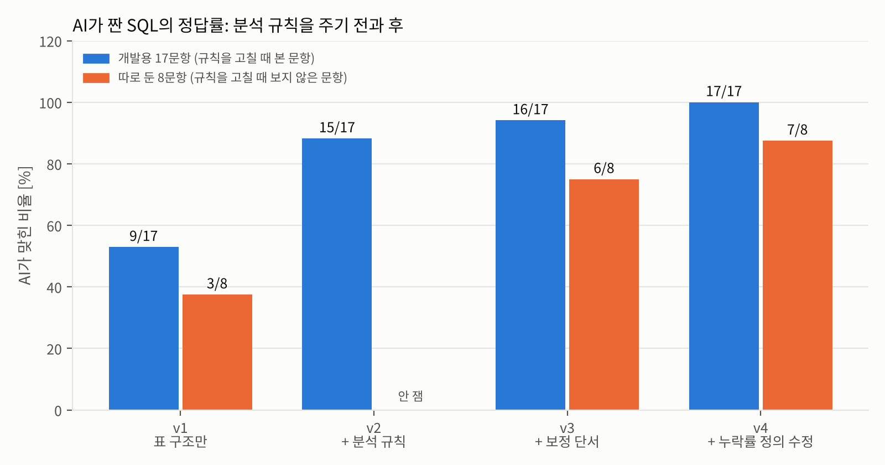
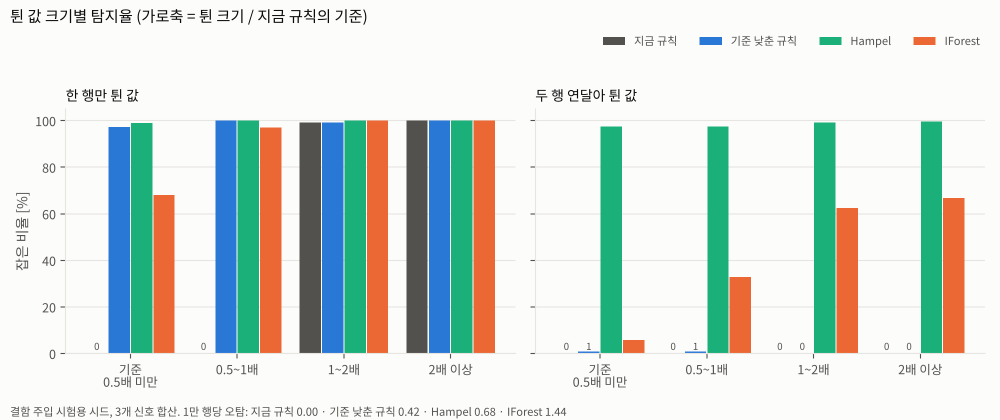

# afa-telemetry-sql — 실주행 로그 SQL 분석 + 품질 검사 자동화 + AI 분석 검증

학생 포뮬러 전기차 팀 A-FA의 실주행 로그(2026-08-11, 세션 10개, 198,027행)를 SQLite로 옮겨 만든 프로젝트입니다.

1. 예전 Python 분석을 SQL로 재현했습니다.
2. 새 로그가 들어오면 품질 검사와 보고서가 자동으로 돌게 했습니다.
3. AI가 SQL을 짜서 답하게 하고, 그 답이 얼마나 맞는지 정답 셋으로 채점했습니다.
4. 품질 규칙 자체가 맞는지 확인했습니다. 결함을 정답과 함께 심어 탐지율을 재고, 통계 필터·머신러닝 모델과 비교했습니다.

SQL을 제대로 익히려고 시작했고, 예제 데이터 대신 직접 만든 계측 시스템([afa2026](https://github.com/tkddn647-ship-it/afa2026))으로 모은 실측 데이터를 썼습니다.
원본 로그(`data/`, `inbox/`)는 팀 데이터라 레포에 올리지 않았습니다. 대신 모양이 같은 가짜 로그(`synth.py`)로 CI가 전체를 돌립니다.

| 숫자 | 뜻 | 근거 |
|--|--|--|
| **0.801 · 0.795 · 0.796** | 부하 구간 팩/인버터 전류 비율 중앙값. 예전 Python 결과를 SQL로 재현 | pandas 교차검증 일치 (`verify.py`) |
| **기울기 0.77, 절편 ≈ 0 A** | 오프셋이 아니라 배율 오류 | 최소제곱 직선 (`sql/03`) |
| **AI SQL 정답률 9/17 → 17/17** | 개발용 17문항. 분석 규칙 정의서를 세 번 고쳐 줌 | `eval_ai_sql.py` |
| **따로 둔 8문항 3/8 → 7/8** | 규칙을 고칠 때 보지 않은 문항 (과적합 확인용) | `eval_ai_sql.py --holdout` |
| **결함 900개 중 시각 결함 900/900** | 정답을 아는 결함을 심어 규칙의 탐지율 측정. 오탐 0 | `eval_detection.py` |
| **두 행 연달아 튄 값: 규칙 0% · Hampel 98.6%** | 지금 규칙의 빈틈. 통계 필터가 가장 나았고 머신러닝 모델(Isolation Forest)은 가장 못했음 | `eval_models.py` |
| **분석 에이전트 핵심 지표 12/12, 주장 재현 26/26** | AI가 세션 하나를 혼자 조사해 보고서를 쓰고, 보고서의 모든 숫자를 SQL로 다시 계산해 확인 | `eval_agent.py` |
| **실시간 판정 10/10 세션 행 단위 일치** | 로그를 한 행씩 흘려 받는 중에 판정한 결과가 주행 뒤 SQL 판정과 같음 | `replay.py --check` |

## 1. SQL로 다시 본 배율 오류


인버터는 배터리에서 전류를 받으므로 팩 전류가 인버터 전류보다 작을 수 없습니다. 그런데 점들이 기준선 아래에 일정한 기울기로 몰려 있습니다.

분석용으로 고른 3세션(오후1·2·6차, 74,062행)으로 예전 결과를 재현했고, 나머지 7세션도 같은 쿼리에 넣었습니다.

| 질문 | SQL로 확인한 것 | 파일 |
|--|--|--|
| 인버터 전류가 팩 전류보다 큰가? | 부하 구간(인버터 25 A 초과) 비율 중앙값: 분석용 3세션 **0.801 · 0.795 · 0.796**, 부하가 있던 7세션 전체 0.795~0.808 | `sql/02` |
| 배율인가, 오프셋인가? | 팩 = a·인버터 + b → **a 0.75~0.80, b −0.5~2.1 A**, R² 0.75~0.93 | `sql/03` |
| 구간마다 비율이 같은가? | 1초 이상 이어진 부하 덩어리 118개의 중앙값 0.72~0.90 | `sql/04` |
| 깨진 행은? | 시각 글자가 빠지거나 끼어든 행, 튄 값: 세션당 0~0.14% | `sql/05` |
| 샘플은 얼마나 빠졌나? | 10 ms 간격 기준 누락률 5.0~12.5%, MCU 재시작은 오후6차 2번 | `sql/06` |
| 보정 1.25 뒤 물리 기준은? | 인버터 > 팩×1.05 인 행: 보정 전 88~98% → 보정 후 18~32% | `sql/07` |
| 두 전류 신호에 시간 차가 있나? | 팩 전류를 ±300 ms 밀어 봐도 상관계수는 0 ms(0.816)에서 가장 높고 거의 평평 → 뚜렷한 지연 없음 | `sql/08` |

**새로 알게 된 것**
- **보정은 가운데만 맞춘다.** 1.25를 곱해도 부하 구간의 18~32%는 여전히 물리 기준을 어깁니다. 시간 차도 없으니 잡음인지 계수가 조금 작은지는 클램프 미터로 실제 전류를 재야 판단됩니다.
- **예전 "구간별 0.79~0.83"은 재현되지 않았다.** 분석용 3세션을 연속 부하 덩어리로 나누면 0.72~0.84입니다. 세션 중앙값과 직선 기울기는 같은 결론이라 판단은 유지했습니다.

## 2. 자동 파이프라인

```bash
python pipeline.py inbox/          # 처음 보는 파일만 넣고 → 품질 검사 → reports/<세션>.md, reports/index.md
```

- 같은 파일은 **내용 해시(SHA-256)** 로 알아보고 다시 넣지 않습니다 (`ingest_log` 표).
- 경고 기준은 코드가 아니라 **`quality_rule` 표**에 있습니다: 누락률 > 8%, 깨진 행 > 0.05%, MCU 재시작 > 0, 보정 뒤 위반 > 30%.
- 분석용 3세션 뒤에 나머지 7개를 넣어 보니, 부하가 있던 7개 세션 모두 비율 중앙값이 **0.795~0.808**로 같은 배율 오류가 나왔습니다 → [`reports/index.md`](reports/index.md)

## 3. AI 분석 도우미와 정확도 평가

```bash
python ask.py "오후2차에서 가장 빨랐던 속도와 그때 인버터 전류는?"
```

AI(Claude Code CLI)가 SQL을 짜고, **사람이 정한 안전장치**를 통과한 쿼리만 실행합니다.

| 안전장치 | 어떻게 |
|--|--|
| 쓰기 불가 | DB를 `mode=ro` + `PRAGMA query_only`로 연다 |
| 한 문장, 읽기만 | SELECT/WITH로 시작하는 한 문장만. INSERT·DROP·PRAGMA·ATTACH 등이 보이면 실행 전 거절 |
| 폭주 방지 | 5초 넘으면 중단, 결과 최대 200행 |
| 오류 처리 | 실행 오류는 AI에게 돌려줘 한 번만 다시 짜게 함 |

### 채점



정답을 아는 질문에 AI가 낸 결과를 정답 쿼리 결과와 비교합니다 (`eval_ai_sql.py`). 열 이름·순서·세션 표시 방식은 보지 않고 값만 봅니다.

| 버전 | AI에게 준 것 | 개발용 17문항 | 따로 둔 8문항 |
|--|--|--|--|
| v1 | 표 구조, 신호 정의, 보정 계수 | 9/17 | 3/8 |
| v2 | + 분석 규칙 8개 ([`prompts/notes_v2.md`](prompts/notes_v2.md)) | 15/17 | 안 잼 |
| v3 | + "질문에 보정이 없으면 원본을 쓴다" 한 줄 | 16/17 | 6/8 |
| v4 | + 누락률 정의 수정 (아래 5절에서 찾은 오류) | **17/17** | **7/8** |

- **v1이 틀린 이유:** 누락률을 "파일 행 수 대비"로 계산, 기록 간격을 라즈베리파이 수신 시각으로 계산(같은 값이 반복돼 0이 나옴), 부하 기준을 25 A가 아니라 10 A로 잡음, 퍼센트를 너무 일찍 반올림. 전부 **이 데이터만의 정의를 몰라서** 생긴 오류였습니다.
- **v2가 새로 틀린 것:** 규칙에 보정 방법을 적었더니 질문에 없는 보정까지 적용 → v3에서 한 줄로 막음.
- **v4:** 누락률 정의(`sql/06`)를 결함 주입 시험에서 고친 뒤 AI용 정의서를 안 고쳐, 분석 에이전트가 옛 정의로 계산했습니다. 정의서를 고치고 정답도 새 정의로 바꾼 뒤 모든 버전을 다시 채점했습니다. 그래서 v2·v3 점수가 처음 잰 값(16/17, 17/17)보다 1문항씩 낮습니다.
- **과적합 확인:** 17문항은 규칙을 고치면서 본 문항이라 17/17은 낙관적입니다. 따로 둔 8문항은 규칙을 고칠 때 보지 않았습니다. 다만 v1·v3 채점 때 결과를 한 번 봤으므로, v4의 7/8은 엄밀히 처음 보는 문항의 점수는 아닙니다 (v4 수정 이유는 이 8문항이 아니라 에이전트 오류).
- **남은 1개 (108번):** "깨진 값은 빼고"를 AI는 모든 종류의 깨진 행으로, 정답은 그 열의 깨진 값만으로 해석했습니다. 질문 자체가 모호합니다.
- 채점 규칙을 바꾼 내역과 이유는 [`AI_LOG.md`](AI_LOG.md)에 있습니다. 바꾼 뒤에는 저장해 둔 모든 버전의 답을 같은 규칙으로 다시 채점했습니다.

## 4. MCP 서버 — Claude에서 이 DB를 바로 조회

`mcp_server.py`는 도구 4개를 내놓습니다: `list_sessions`, `describe_schema`(분석 규칙 포함), `run_select`(같은 안전장치), `session_quality`.

```json
{ "mcpServers": { "afa-telemetry": { "command": "python", "args": ["<경로>/mcp_server.py"] } } }
```

`mcp_test.py`가 서버를 실제로 띄워 확인합니다: 세션 행 수 합 = DB 행 수, 비율 중앙값 일치, 쓰기 시도 4개 모두 거절되고 행 수 그대로.

## 5. 분석 에이전트 — 세션 하나를 AI가 혼자 조사

```bash
python agent.py 오후2차            # → reports/agent_오후2차.md
python eval_agent.py               # 정답을 아는 세션 3개로 채점 → eval/agent_report.md
```

AI가 위의 MCP 도구만 써서 세션을 조사하고, 정해진 형식(JSON 스키마)으로 보고서를 냅니다. **보고서의 주장마다 AI가 쓴 SQL을 프로그램이 다시 실행**해 같은 값이 나오는지 확인한 뒤 표시합니다.

| 시험 | 결과 |
|--|--|
| 결함을 심은 세션 3개 (정답 있음) | 핵심 지표 4개 x 3 = **12/12**, 규칙에 없는 '신호 멈춤' **3/3** 발견, 주장 재현 **26/26** |
| 실제 로그 오후2차 (정답 없음) | 주장 14개 모두 재현. 품질 규칙에 없는 이상을 찾음: `bms_charge` 세션 내내 0, `bms_ccl` 세션 내내 12, 온도·전압·전류 한계값 열에서 한 행만 튀는 값 6개 (예: 278.1 → 78.1 → 278.1 V) |

- **처음엔 12개 중 8개만 맞았습니다.** 원인 둘: AI용 정의서가 옛 누락률 정의였고(→ v4), 재시작 정답을 결함 주입 기록이 아니라 규칙 값으로 맞춰야 했습니다. 둘 다 [`AI_LOG.md`](AI_LOG.md)에.
- **한계:** 작업 지시에 "값이 멈춘 신호"라는 이상 종류를 예로 들었습니다. 3/3은 힌트를 받고 찾은 결과입니다. 힌트 없는 시험은 아직 안 했습니다.
- 실제 로그에서 찾은 것은 **이상 후보**입니다. `bms_charge`가 0인 것이 BMS 설정인지 CAN 수신 문제인지는 팀이 확인해야 합니다.

## 6. 품질 규칙을 믿어도 되나 — 결함 주입과 모델 비교

### 6-1. 정답을 아는 결함을 심어 탐지율 재기

`faults.py`가 실제 로그에서 본 모양 그대로 결함을 심고, 어느 행에 무엇을 심었는지 정답 파일을 남깁니다. 시각 글자 빠짐·끼어듦·두 행 연속, 값 튐(작은 것부터 큰 것까지), 연속 행 빠짐, MCU 재시작.

`python eval_detection.py` (분석용 3세션 x 시드 5개, 368,508행):
- 시각 결함 **900/900**, 오탐 0. 빠진 샘플은 심은 1,612개 중 1,609개를 셈, MCU 재시작 30/30.
- 튄 값은 **규칙 기준보다 크면 거의 다(1~2배 91/92, 2배 이상 252/252), 작으면 하나도 못 잡음 (0/331)**.
- **이 시험에서 규칙 버그를 하나 찾았습니다.** 깨진 시각 행을 빠진 샘플로 한 번 더 세고 있었습니다 (심은 344개를 524개로 셈). `sql/06`을 고친 뒤 1,609/1,612. 실제 로그에는 깨진 시각 행이 적어 영향이 작았습니다 (오후1차 누락률 9.2% → 9.1%).

### 6-2. 기준을 낮추면 되나, 모델이 필요한가



`python eval_models.py` → [`eval/models_report.md`](eval/models_report.md). 같은 결함 데이터에서 네 방법을 비교했습니다.

| 방법 | 어떻게 판단 |
|--|--|
| 지금 규칙 | 앞뒤 행 둘 다와 기준(200 A 등) 넘게 다르고, 앞뒤끼리는 가까우면 깨진 값 |
| 기준 낮춘 규칙 | 같은 모양, 기준값만 데이터로 다시 정함 |
| Hampel 필터 | 앞뒤 3행씩 7행의 중앙값에서 '중앙값 절대편차'의 k배 넘게 벗어나면 이상 |
| Isolation Forest | scikit-learn의 이상 탐지 모델. 앞 행·뒤 행·창 중앙값과의 차이를 특징으로 |

공정하게 하려고: 기준값은 시드 1~3에서 정하고 시드 4~6에서 쟀습니다. 오탐은 1만 행당 1개 이하로 맞췄습니다. 결함을 심기 전부터 데이터에 있던 이상 후보는 채점에서 뺐습니다.

- **한 행만 튄 값:** 기준만 낮춰도 0.5배 미만 크기까지 97% 잡습니다. 값이 CAN 주기 때문에 몇 행씩 같은 값으로 반복되는 데이터라, '한 행만 다르다'는 모양 자체가 강한 신호였습니다.
- **두 행 연달아 튄 값:** 지금 규칙은 1000 A가 튀어도 **0%** 입니다. 두 행이 서로 같아서 '앞뒤와 다르다' 조건을 못 채웁니다. Hampel은 전체 98.6% (799/810).
- **머신러닝 모델이 가장 못했습니다.** 같은 오탐 기준에서 작은 튐과 두 행 튐을 덜 잡았고, 조정용 시드에서 정한 기준이 시험용 시드에서 오탐이 1만 행당 1.44개(3개 신호 합산)로 허용치 1개를 넘었습니다. 신호 하나의 튄 값에는 데이터 구조에 맞춘 단순한 필터가 더 맞았습니다.
- **결함을 심기 전 데이터에도 규칙이 놓친 이상 후보가 15개 있었습니다.** 44.4 → 4.4 → 44.4 A, 106.7 → 6.7 → 106.7 A, 34.6 → 12.4 → 34.6 km/h (10 ms 만에 22 km/h는 물리적으로 불가능). 시각처럼 **값도 숫자 글자가 빠지거나 바뀌는 모양**입니다. 5절의 에이전트가 오후2차에서 찾은 온도·전압 튐도 같은 모양입니다. 원인은 추정이고 확인이 필요합니다 (UART 수신 문자열 손상일 가능성).

**아직 규칙에 반영하지 않았습니다.** `sql/01`을 바꾸면 AI 평가 정답, 교차검증, 추적표가 모두 바뀌므로 따로 할 일로 남겼습니다. 바꾼다면: Hampel 모양 검사를 3개 열이 아닌 모든 숫자 열에 적용.

## 7. 요구사항 추적표 — 품질 기준을 요구사항으로

`requirements.yaml`에 요구사항 13개(데이터 품질 8개, 시스템 5개)를 적고, `python trace.py`가 각 요구사항을 SQL로 판정합니다.

- [`reports/traceability.md`](reports/traceability.md): 세션 x 요구사항 85칸 — 통과 60 · 실패 16 · 해당 없음 9 (부하가 없는 세션)
- [`reports/defects.md`](reports/defects.md): 실패 16건마다 결함 번호, 측정값, **다시 확인하는 SQL**. REQ-05(배율)는 원인과 조치(보정 계수 1.25, REQ-06에서 확인)까지.
- REQ-08(속도 범위) 하한은 처음 0이었는데, 정지 중 속도가 −0.58 km/h까지 나오는 영점 오차가 있어 −1로 고쳤습니다. 이 결정도 `requirements.yaml`에 이유와 함께 적었습니다.

## 8. 실시간 리플레이 — 주행 중에 경고

```bash
python replay.py data/sensor_log_20260811_오후7차.csv.gz --realtime   # 100 Hz로 흘리며 화면에 경고
python replay.py --check                                             # 모든 세션에서 SQL 판정과 행 단위 비교
```

주행 뒤 DB에서 하던 검사를 받는 중에 합니다. 판정 규칙은 SQL과 같고, 앞뒤 두 행을 봐야 하므로 판정이 2행(약 20 ms) 늦습니다.

- **10개 세션 모두 SQL 판정과 행 단위로 같습니다** (깨진 행 표시, 빠진 샘플 수, 재시작 수).
- 첫 누락률 경고: 오후7차 13초째, 오후6차 32초째, 오후1차 67초째 → [`reports/replay.md`](reports/replay.md)
- 고친 것 둘: 누락률이 8% 근처에서 경고가 켜졌다 꺼졌다 반복 → 7% 아래로 내려가야 끄도록 함. 가속 페달을 뗀 0 A 근처 타력 주행을 '신호 멈춤'으로 오인 → |전류| ≥ 5 A일 때만 검사.

## CI — 원본 없이 전체 검사

`synth.py`가 실제 로그와 모양만 같은 가짜 로그(0.8 배율, 약 5% 누락)를 만들고, GitHub Actions가 push마다 `ci.sh`로 적재 → SQL 분석 → 결함 주입 검사 → 결과 확인(`ci_check.py`)을 돌립니다.

## 표 구조

```
session ─< sample (session_id, row_no)        signal_def ─ scale_correction (보정 계수 1.25)
   └─ ingest_log (sha256)                      quality_rule (경고 기준)       load_issue
뷰: sample_flags (깨진 값 표시) · sample_clean (깨진 행 제외) · sample_corrected (보정 적용)
```

보정 계수와 경고 기준을 쿼리·코드에 숫자로 박지 않고 표로 둔 이유: 바꾸면 모든 쿼리가 따라 바뀌고, 왜 그 값인지가 데이터와 같이 남습니다.

## 실행

```bash
python load.py data/*.csv.gz   # DB 새로 만들기 (분석용 3세션)
python pipeline.py inbox/      # 새 로그 자동 처리
python run.py                  # sql/ 분석 → results.md
python verify.py               # pandas 교차검증
python ask.py "질문"           # AI 분석 도우미 (Claude Code CLI 필요)
python eval_ai_sql.py v4       # AI 채점 (--holdout, --regrade)
python agent.py 오후2차        # 분석 에이전트 (Claude Code CLI 필요)
python eval_detection.py       # 결함 주입 탐지율
python eval_models.py          # 규칙 vs Hampel vs Isolation Forest (scikit-learn 필요)
python trace.py                # 요구사항 추적표, 결함 목록
python replay.py --check       # 실시간 판정 = SQL 판정 확인
python make_figures.py         # figures/
bash test_all.sh               # AI를 부르지 않는 검사 전부
```

Python 3.11+, pandas, numpy, matplotlib, PyYAML, `mcp`, scikit-learn(`eval_models.py`만). DB는 Python 내장 sqlite3.

## 쓴 SQL 기능

창 함수(`ROW_NUMBER`, `LAG`/`LEAD` 2칸, `COUNT() OVER`) · MEDIAN 없이 중앙값 · gaps-and-islands · 집계로 최소제곱 직선·상관계수 ·
재귀 CTE · `MATERIALIZED` CTE와 `CROSS JOIN`으로 조인 순서 고정(2분 → 3초) · 뷰 · 읽기 전용 URI 연결

## 한계

- 결함 주입 시험의 결함은 **실제 로그에서 본 모양을 흉내 낸 것**입니다. 실제로 일어나는 결함의 종류와 비율은 모릅니다.
- 모델 비교는 신호 하나의 튄 값만 다룹니다. 신호 여러 개를 같이 봐야 하는 이상(예: 접촉기가 닫혔는데 전압 차가 큼)은 비교하지 않았습니다.
- AI 평가 문항이 25개라 1문항이 4~12%포인트를 움직입니다.
- 보정 계수 1.25가 맞는지는 실제 전류를 따로 재기 전에는 확정할 수 없습니다.

## AI 사용과 내 역할

코드와 쿼리 초안은 Claude와 함께 썼습니다. AI가 쓴 쿼리에서 실제로 고친 것, 채점 규칙을 바꾼 이유는 [`AI_LOG.md`](AI_LOG.md)에 남겼습니다.
SQL 자체는 [`study/`](study/)의 연습 문제 12개로 따로 익히고 있습니다.
