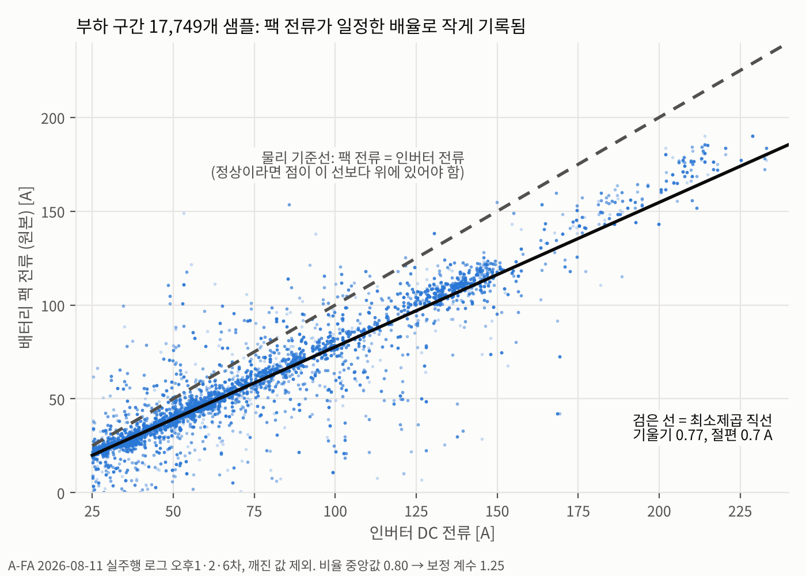
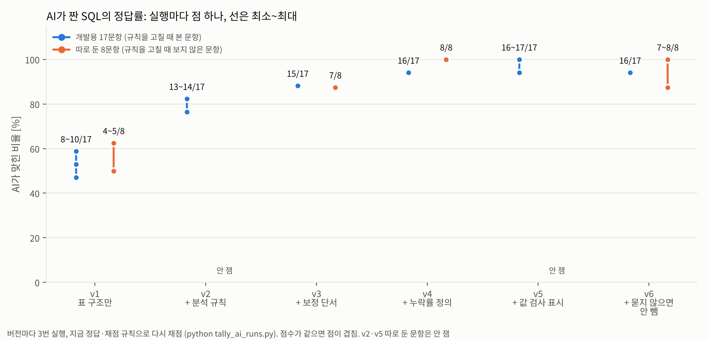
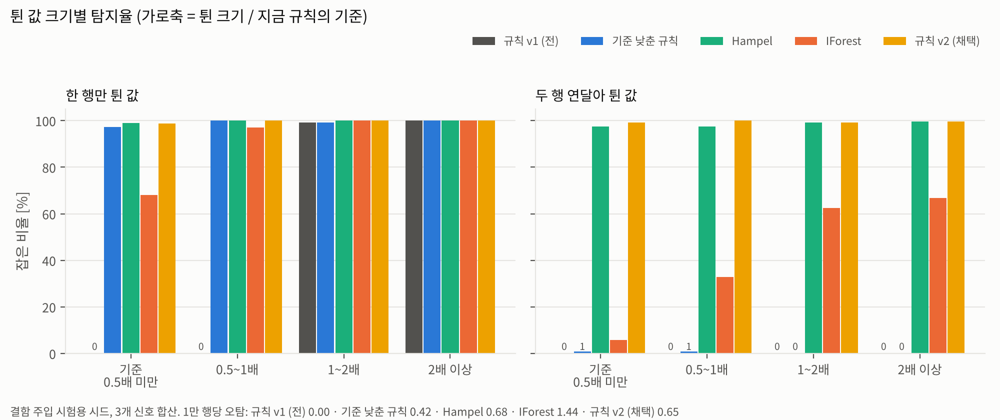

# 전체 과정 (상세)

> 한 쪽 요약은 [README](../README.md). 이 문서는 진행 순서대로 모든 결과·고친 것·한계를 적은 원문입니다.

## 처음 소개

학생 포뮬러 전기차 팀 A-FA의 실주행 로그(2026-08-11, 세션 10개, 198,027행)를 SQLite로 옮겨 만든 프로젝트입니다.

1. 예전 Python 분석을 SQL로 재현했습니다.
2. 새 로그가 들어오면 품질 검사와 보고서가 자동으로 돌게 했습니다.
3. AI가 SQL을 짜서 답하게 하고, 그 답이 얼마나 맞는지 정답 셋으로 채점했습니다.
4. 품질 규칙 자체가 맞는지 확인했습니다. 결함을 정답과 함께 심어 탐지율을 재고, 통계 필터·머신러닝 모델과 비교했습니다.
5. 거기서 찾은 규칙의 빈틈을 고쳐(규칙 v2) 모든 숫자 열에 적용하고, 위 1~4를 전부 다시 돌려 확인했습니다.

SQL을 제대로 익히려고 시작했고, 예제 데이터 대신 팀 계측 시스템([afa2026](https://github.com/tkddn647-ship-it/afa2026))으로 모은 실측 데이터를 썼습니다.
원본 로그(`data/`, `inbox/`)는 팀 데이터라 레포에 올리지 않았습니다. 대신 모양이 같은 가짜 로그(`synth.py`)로 CI가 전체를 돌립니다.

| 숫자 | 뜻 | 근거 |
|--|--|--|
| **0.801 · 0.795 · 0.796** | 부하 구간 팩/인버터 전류 비율 중앙값. 예전 Python 결과를 SQL로 재현 | pandas 교차검증 일치 (`verify.py`) |
| **기울기 0.77~0.78, 절편 ±2 A 안** | 오프셋이 아니라 배율 오류 | 최소제곱 직선 (`sql/03`) |
| **AI SQL 정답률 8~10/17 → 16/17** | 개발용 17문항, 버전마다 3번 실행한 최소~최대. 분석 규칙 정의서를 다섯 번 고쳐 줌 (지금 쓰는 v6, 3번 모두 16) | `eval_ai_sql.py`, `tally_ai_runs.py` |
| **따로 둔 8문항 4~5/8 → 7~8/8** | 규칙을 고칠 때 보지 않은 문항 (과적합 확인용), 3번씩 | `eval_ai_sql.py --holdout` |
| **두 행 연달아 튄 값: 규칙 v1 0% → v2 99.5%** | 결함 주입으로 찾은 규칙의 빈틈. 통계 필터·머신러닝 모델(Isolation Forest)과 비교한 뒤 데이터 구조에 맞춘 규칙으로 고침 | `eval_models.py` |
| **실제 로그의 깨진 행 88 → 610행** | 규칙 v1이 놓치던 손상. 573행이 값 튐이고 그중 79%가 '한 줄 전체 손상'이나 '숫자 글자 1~2개 차이' 모양 | `value_check.py` |
| **분석 에이전트: 숨긴 이상 30/36 → 36/36** | AI가 세션 하나를 혼자 조사해 보고서를 쓰고, 모든 숫자를 SQL로 다시 계산해 확인. 이상 하나 찾고 멈추는 문제를 '열 요약 도구 + 모든 열 확인' 지시로 고침 (처음 보는 이상 종류 9/9 포함, 실행 간 흔들림 8~12 → 12~12) | `eval_agent_blind.py` |
| **'프리차지 미달 6/6'은 신호 정의 결함이었음** | 여러 신호 규칙으로 차량 규정(KSAE 제52조, 90%)을 점검하다 발견. 펌웨어가 초기충전 시작(VSM 2)을 '접촉기 닫힘'으로 기록. 경계값 시험 24/24 | `sql/10`, `eval_cross.py`, afa2026 `can_vehicle.c` |
| **깨진 행 ≈ 그 밖 누락 x 0.106 (10세션 상관 0.999)** | 줄이 빠지는 것과 깨지는 것이 같은 원인. 이 비율로 수정 펌웨어 효과를 세션 하나로 판정 (사본 시험 33/36). 누락의 5%는 200 ms 주기로 ECU 온도 읽기와 묶여 있음 | `sql/11`, `history.py` |
| **같은 규칙의 세 구현이 1,319칸 모두 일치** | SQL · pandas · 실시간(한 행씩) 판정이 10개 세션에서 (세션, 행, 열) 단위로 같음 | `verify.py`, `replay.py --check` |

## 1. SQL로 다시 본 배율 오류



인버터는 배터리에서 전류를 받으므로 팩 전류가 인버터 전류보다 작을 수 없습니다. 그런데 점들이 기준선 아래에 일정한 기울기로 몰려 있습니다.

분석용으로 고른 3세션(오후1·2·6차, 74,062행)으로 예전 결과를 재현했고, 나머지 7세션도 같은 쿼리에 넣었습니다.

| 질문 | SQL로 확인한 것 | 파일 |
|--|--|--|
| 인버터 전류가 팩 전류보다 큰가? | 부하 구간(인버터 25 A 초과) 비율 중앙값: 분석용 3세션 **0.801 · 0.795 · 0.796**, 부하가 있던 7세션 전체 0.795~0.808 | `sql/02` |
| 배율인가, 오프셋인가? | 팩 = a·인버터 + b → **a 0.75~0.80, b −0.8~1.7 A**, R² 0.75~0.93 | `sql/03` |
| 구간마다 비율이 같은가? | 1초 이상 이어진 부하 덩어리 116개의 중앙값 0.72~0.90 | `sql/04` |
| 깨진 행은? | 시각 글자가 빠지거나 끼어든 행, 튄 값(30열 검사): 세션당 0~0.99% (규칙 v1로는 0~0.14%) | `sql/05` |
| 샘플은 얼마나 빠졌나? | 10 ms 간격 기준 누락률 5.0~12.5%, MCU 재시작은 오후6차 2번 | `sql/06` |
| 보정 1.25 뒤 물리 기준은? | 인버터 > 팩×1.05 인 행: 보정 전 88~98% → 보정 후 18~32% | `sql/07` |
| 두 전류 신호에 시간 차가 있나? | 팩 전류를 ±300 ms 밀어 봐도 상관계수는 0 ms(0.816)에서 가장 높고 거의 평평 → 뚜렷한 지연 없음 | `sql/08` |

**새로 알게 된 것**
- **보정은 가운데만 맞춘다.** 1.25를 곱해도 부하 구간의 18~32%는 여전히 물리 기준을 어깁니다. 시간 차도 없으니 잡음인지 계수가 조금 작은지는 클램프 미터로 실제 전류를 재야 판단됩니다.
- **예전 "구간별 0.79~0.83"은 재현되지 않았다.** 분석용 3세션을 연속 부하 덩어리로 나누면 0.72~0.84입니다. 세션 중앙값과 직선 기울기는 같은 결론이라 판단은 유지했습니다.
- **규칙 v2로 깨진 행을 더 빼도 결론은 같다.** 비율 중앙값 0.801·0.795·0.796은 그대로이고, 직선의 R²는 오후6차 0.766 → 0.782처럼 조금 좋아졌습니다.

## 2. 자동 파이프라인

```bash
python pipeline.py inbox/          # 처음 보는 파일만 넣고 → 품질 검사 → reports/<세션>.md, reports/index.md
```

- 같은 파일은 **내용 해시(SHA-256)** 로 알아보고 다시 넣지 않습니다 (`ingest_log` 표).
- 경고 기준은 코드가 아니라 **`quality_rule` 표**에 있습니다: 누락률 > 8%, 깨진 행 > 0.05%, MCU 재시작 > 0, 보정 뒤 위반 > 30%.
- 튄 값 검사(규칙 v2)는 30열 x 20만 행이라 매번 계산하면 약 15초 → **새로 넣은 세션만** 계산해 `value_flag` 표에 둡니다.
- 분석용 3세션 뒤에 나머지 7개를 넣어 보니, 부하가 있던 7개 세션 모두 비율 중앙값이 **0.795~0.808**로 같은 배율 오류가 나왔습니다 → [`reports/index.md`](../reports/index.md)

## 3. AI 분석 도우미와 정확도 평가

```bash
python ask.py "오후2차에서 가장 빨랐던 속도와 그때 인버터 전류는?"
```

AI(Claude Code CLI)가 SQL을 짜고, **사람이 정한 안전장치**를 통과한 쿼리만 실행합니다.

| 안전장치 | 어떻게 |
|--|--|
| 쓰기 불가 | DB를 `mode=ro` + `PRAGMA query_only`로 연다 |
| 한 문장, 읽기만 | SELECT/WITH로 시작하는 한 문장만. INSERT·DROP·PRAGMA·ATTACH 등이 보이면 실행 전 거절 |
| 폭주 방지 | 5초 넘으면 중단, 결과 최대 200행 |
| 오류 처리 | 실행 오류는 AI에게 돌려줘 한 번만 다시 짜게 함 |

### 채점



정답을 아는 질문에 AI가 낸 결과를 정답 쿼리 결과와 비교합니다 (`eval_ai_sql.py`). 열 이름·순서·세션 표시 방식은 보지 않고 값만 봅니다.

| 버전 | AI에게 준 것 | 개발용 17문항 (3번) | 따로 둔 8문항 (3번) |
|--|--|--|--|
| v1 | 표 구조, 신호 정의, 보정 계수 | 8~10 (9·10·8) | 4~5 (4·5·4) |
| v2 | + 분석 규칙 8개 ([`prompts/notes_v2.md`](../prompts/notes_v2.md)) | 13~14 (14·14·13) | 안 잼 |
| v3 | + "질문에 보정이 없으면 원본을 쓴다" 한 줄 | 15 (15·15·15) | 7 (7·7·7) |
| v4 | + 누락률 정의 수정 (6-1절에서 찾은 버그) | 16 (16·16·16) | 8 (8·8·8) |
| v5 | + 깨진 값 규칙 v2의 표시 `bad_value`·`n_bad_cols` | 16~17 (16·16·17) | 안 잼 |
| **v6 (지금 씀)** | + "부하 구간 말고는, 묻지 않으면 깨진 값 표시로 행을 빼지 않는다" | **16 (16·16·16)** | **7~8 (7·8·8)** |

버전마다 **3번 실행한 최소~최대**입니다. 같은 지시로 돌려도 AI 답이 달라서, 한 번 점수로 버전을 비교하면 우연을 개선으로 읽을 수 있습니다 (Atil 외 2024는 실행 간 최소~최대 보고를 권함). 처음엔 v4~v6 개발용만 3번 돌렸고, 나머지를 맞춰 다시 돌렸습니다. 모든 실행을 **지금의 정답·채점 규칙으로 다시 채점**했습니다 (`python tally_ai_runs.py` → `eval/ai_runs.json`, AI를 다시 부르지 않음).

- **범위로 보니 달라진 해석:** v1의 9/17은 8~10 사이 한 값이었고, v1→v2(+분석 규칙)의 개선은 범위가 겹치지 않아 우연이 아닙니다 (8~10 → 13~14). v3 이후 버전끼리는 범위가 1문항 안에서 겹쳐, **v4·v5·v6의 차이는 이 문항 수로는 구분되지 않습니다.** v6 따로 둔 문항의 '7/8'도 7~8이었습니다.

- **v1이 틀린 이유:** 누락률을 "파일 행 수 대비"로 계산, 기록 간격을 라즈베리파이 수신 시각으로 계산(같은 값이 반복돼 0이 나옴), 부하 기준을 25 A가 아니라 10 A로 잡음, 퍼센트를 너무 일찍 반올림. 전부 **이 데이터만의 정의를 몰라서** 생긴 오류였습니다.
- **v2가 새로 틀린 것:** 규칙에 보정 방법을 적었더니 질문에 없는 보정까지 적용 → v3에서 한 줄로 막음.
- **v4:** 누락률 정의(`sql/06`)를 결함 주입 시험에서 고친 뒤 AI용 정의서를 안 고쳐, 분석 에이전트가 옛 정의로 계산했습니다.
- **v4가 지금 13번을 틀리는 이유:** 규칙 v2로 '깨진 행'의 정의가 바뀌었는데 v4 정의서는 옛 정의(표시 4개)라서. v4의 예전 17/17은 옛 정의 기준이었습니다.
- **v5 → v6:** v5는 깨진 값 표시를 설명하자 "평균 속도보다 빠른 샘플 수"(6번) 같은 묻지 않은 질문에서도 깨진 행을 빼는 일이 3번 중 2번 생겼습니다 (v2의 보정 과적용과 같은 모양). v6에서 한 줄로 막음.
- **v6이 틀리는 17번:** "가장 빨랐던 순간의 속도와 그때 인버터 전류" — 최고 속도가 19행 동안 유지됐고 그 사이 전류가 55.8 → 56.3 A로 바뀝니다. v6은 19행을 다 보여 주고 정답은 첫 행 하나라 틀림으로 셌습니다. 질문이 모호합니다.
- **왜 v5가 아니라 v6인가:** 3번 평균은 v5가 조금 높습니다(16.3 vs 16.0). 하지만 v5의 오답은 숫자를 말없이 바꾸고(묻지 않았는데 행을 뺌), v6의 오답은 정보를 더 보여 준 쪽이라 v6을 씁니다.
- **과적합 확인:** 따로 둔 8문항은 규칙을 고칠 때 보지 않았습니다. 다만 v1·v3·v4 채점 때 결과를 봤으므로 v6의 7/8은 엄밀히 처음 보는 문항의 점수가 아닙니다. v5를 만들 때 이 8문항의 108번을 겨냥한 문장을 하나 넣었다가, 그게 과적합이라 지웠습니다.
- **따로 둔 문항의 변화도 우연이 섞였습니다:** v4가 8/8이 된 것은 규칙 v2로 108번의 두 해석이 같은 값을 내게 됐기 때문이고 AI가 나아진 게 아닙니다. v6은 105번 "세션 전체 샘플 중 부하 구간 비율"을 '모든 세션 합쳐서'로 읽어 틀렸습니다.
- 채점 규칙과 정답을 바꾼 내역과 이유는 [`AI_LOG.md`](../AI_LOG.md)에 있습니다. 동점 행을 인정하는 채점 규칙을 넣어 봤다가, 어떤 점수도 바꾸지 않아서 뺐습니다.

## 4. MCP 서버 — Claude에서 이 DB를 바로 조회

`mcp_server.py`는 도구 5개를 내놓습니다: `list_sessions`, `describe_schema`(분석 규칙 포함), `run_select`(같은 안전장치), `session_quality`, `column_profile`(열마다 요약: 최소·중앙값·최대, 서로 다른 값 수, 0 비율, 같은 값이 가장 오래 이어진 구간, 한 행 사이 가장 큰 변화 — 5절 v2용).

```json
{ "mcpServers": { "afa-telemetry": { "command": "python", "args": ["<경로>/mcp_server.py"] } } }
```

`mcp_test.py`가 서버를 실제로 띄워 확인합니다: 세션 행 수 합 = DB 행 수, 비율 중앙값 일치, 쓰기 시도 4개 모두 거절되고 행 수 그대로.

## 5. 분석 에이전트 — 세션 하나를 AI가 혼자 조사

```bash
python agent.py 오후2차            # → reports/agent_오후2차.md
python eval_agent.py               # 정답을 아는 세션 3개로 채점 → eval/agent_report.md
python eval_agent_blind.py 3       # 숨긴 이상 3종, 힌트 있음/없음 x 3번 → eval/agent_blind_report.md
```

AI가 위의 MCP 도구만 써서 세션을 조사하고, 정해진 형식(JSON 스키마)으로 보고서를 냅니다. **보고서의 주장마다 AI가 쓴 SQL을 프로그램이 다시 실행**해 같은 값이 나오는지 확인한 뒤 표시합니다.

| 시험 | 결과 |
|--|--|
| 결함을 심은 세션 3개 (정답 있음) | 핵심 지표 4개 x 3 = **12/12**, 규칙에 없는 '신호 멈춤' **3/3** 발견, 주장 재현 **23/23** (지시문에 '멈춘 신호' 힌트 있음, 1번 실행) |
| **blind 시험:** 세션 3개에 규칙에 없는 이상 3종을 숨김 (인버터 전류 300행 멈춤, 인버터 전압만 25 V 낮아짐, 모터는 도는데 속도 0) | 힌트 없음 **21/27** (전류 멈춤 8/9, 전압 6/9, 속도 0 7/9), 힌트 있음 20/27. 한 실행에서 찾은 수 5~9개 (9개 중). 주장 재현 **135/135** |
| 실제 로그 오후2차 (정답 없음) | 주장 7개 모두 재현. 여러 신호를 같이 봐야 보이는 이상을 찾음: 메인 접촉기가 닫혔는데 인버터 전압이 팩 전압의 90% 미만 (88행, 나중에 신호 정의 결함으로 밝혀짐: 6-4절), 인버터 전류 28.6 A인데 팩 전류 0~0.1 A (14행) |

- **처음엔 12개 중 8개만 맞았습니다.** 원인 둘: AI용 정의서가 옛 누락률 정의였고(→ v4), 재시작 정답을 결함 주입 기록이 아니라 규칙 값으로 맞춰야 했습니다. 둘 다 [`AI_LOG.md`](../AI_LOG.md)에.
- **에이전트가 찾은 것이 규칙이 됐습니다.** 첫 실행에서 에이전트가 오후2차에서 "규칙에 안 잡히는 한 행 튐" 6개(278.1 → 78.1 V, 42 → 420 ℃ 등)를 찾았고, 이것이 규칙 v2(6-3절)의 출발점 중 하나였습니다. 지금은 6개 모두 규칙이 잡습니다.
- **힌트를 빼도 결과가 같았습니다.** 처음 시험(3/3)은 지시문에 "값이 멈춘 신호, 신호끼리 모순되는 구간"을 예로 들어, 찾은 것이 지시문 덕인지 알 수 없었습니다. 그 구절을 빼고 이상을 3종으로 늘려 3번씩 돌리니 힌트 없음 21/27, 있음 20/27로 차이가 없었습니다 (표본이 작아 '힌트가 필요 없다'까지는 말할 수 없습니다).
- **대신 실행마다 크게 흔들립니다.** 같은 세션에서 9개 다 찾은 실행도, 하나만 찾은 실행도 있습니다. 놓친 실행을 보면 이상 하나를 찾으면 거기서 조사를 멈추는 경우가 많았습니다 (예: 시험2 1번째 실행은 속도 0 하나만 보고). 처음 시험의 3/3도 1번 실행이라 운이 섞였을 수 있습니다.
- 숨긴 구간은 값 검사에 한 행도 걸리지 않게 만들었습니다 (계단이 300행 이어져 50 ms 조건에 안 걸림). 원래 로그에도 '접촉기 1인데 인버터·팩 전압 15 V 넘게 차이' 모양이 1~4번 있는데, 초기충전 구간입니다 (6-4절).
- 심은 이상과 겹치지 않는 발견(MCU 재시작, 기록 멈춤 등 기존 지표와 같은 것 포함) 32개는 오탐인지 원래 로그의 이상인지 따로 확인하지 않았습니다.

**고친 것: 지시문 v2 (`agent.py`의 기본값)**

이상 하나 찾고 멈추는 것을 막으려고 두 가지를 넣었습니다. 이상 종류는 여전히 알려 주지 않습니다.
- `column_profile` 도구: 열마다 일반적인 품질 지표를 한 번에 줌 (Schelter 외 2018의 열 프로파일과 같은 생각).
- 지시: "모든 열의 요약을 먼저 보고 열마다 한 번씩 확인해라. 다른 열과 함께 봐야 이상인 것도 있다. 하나 찾았다고 멈추지 마라. 확인한 열을 적어라."

지시문을 고칠 때 본 시험(시드 10)에 맞춘 것이 아닌지 보려고, **새 위치(시드 20)와 고칠 때 보지 않은 종류(팩 전류만 절반)**로 다시 쟀습니다 (`python eval_agent_blind.py 3 --seed 20 --modes blind,v2 --kinds stuck,v_offset,speed_0,bms_half --tag r2`).

| 지시문 | 전류 멈춤 | 전압 −25 V | 속도 0 | 팩 전류 절반 (처음 보는 종류) | 합계 | 실행별 (12개 중) | 주장 재현 | 평균 시간·비용 |
|--|--|--|--|--|--|--|--|--|
| blind | 7/9 | 8/9 | 8/9 | 7/9 | 30/36 | 8~12 | 66/66 | 120초, $0.64 |
| **v2** | **9/9** | **9/9** | **9/9** | **9/9** | **36/36** | **12~12** | 98/99 | 159초, $1.10 |

- v2는 9번 실행 모두 12개를 다 찾았습니다. 대신 시간이 약 1.3배, 비용이 약 1.7배입니다.
- 재현 안 된 1개: "한 행만 켜진 상태 비트" 주장에서 AI가 낸 값(2)과 SQL 결과(4)가 다름. 이렇게 걸러 내려고 재실행 검사를 둔 것입니다.
- **v2가 규칙의 빈틈을 하나 찾았습니다:** 서스펜션 값이 한 행만 정확히 +10이나 +20 뛰는 행 (7.34 → 27.34, 0.49 → 20.49). 숫자 글자 하나가 끼어든 모양(6-3절)인데, 서스펜션 기준이 열 범위의 1배(약 25)라 값 검사에 안 걸렸습니다. → 6-3절의 숫자 글자 검사로 막음 (실제 로그 9행 새로 표시).
- **짧은 이상 (50행 = 0.5초, 시드 30, v2만 3번):** **32/36** (전류 멈춤 9/9, 전압 8/9, 속도 0 8/9, 팩 전류 절반 7/9), 실행별 10~12개, 주장 재현 95/95, 평균 203초·$1.21. 300행보다 조금 떨어집니다 (`--length 50 --tag r3short`).
- 한계: 세션 3개, 시드 3개, 실행 3번씩입니다. 열 요약의 '같은 값이 가장 오래 이어진 구간'은 전류 멈춤을 직접 보여 주는 지표라, 그 종류의 개선은 도구 덕이 큽니다. 처음 보는 종류(팩 전류 절반)도 7/9 → 9/9였습니다.
- 실제 로그에서 찾은 것은 **이상 후보**입니다. 원인은 팀이 확인해야 합니다.

## 6. 품질 규칙을 믿어도 되나 — 결함 주입과 모델 비교

### 6-1. 정답을 아는 결함을 심어 탐지율 재기

`faults.py`가 실제 로그에서 본 모양 그대로 결함을 심고, 어느 행에 무엇을 심었는지 정답 파일을 남깁니다. 시각 글자 빠짐·끼어듦·두 행 연속, 값 튐(작은 것부터 큰 것까지), 연속 행 빠짐, MCU 재시작.

`python eval_detection.py` (분석용 3세션 x 시드 5개):

| | 규칙 v1 (처음) | 규칙 v2 (지금) |
|--|--|--|
| 깨진 시각 3종 | 900/900 | 899/900 |
| 튄 값 (인버터·팩 전류·속도) | 343/675 (기준보다 작으면 0/331) | 672/675 |
| 오탐 | 0 | 18 (모두 심은 결함·뺀 행 자리에서 2행 안, 떨어진 곳 0) |
| 빠진 샘플 / MCU 재시작 | 1,609/1,612 · 30/30 | 1,574/1,578 · 30/30 |

- **이 시험에서 규칙 버그를 하나 찾았습니다.** 깨진 시각 행을 빠진 샘플로 한 번 더 세고 있었습니다 (심은 344개를 524개로 셈). `sql/06`을 고친 뒤 1,609/1,612. 실제 로그에는 깨진 시각 행이 적어 영향이 작았습니다 (오후1차 누락률 9.2% → 9.1%).
- **v2에서 놓친 시각 1개:** 깨진 시각이 실제 MCU 재시작 바로 앞 행에 오면 '앞뒤 간격 0~200 ms' 조건이 성립하지 않습니다. 결함 위치를 옮겨 숨기지 않고 그대로 남겼습니다 (REQ-09 실패).
- **v2의 오탐 18개:** 깨진 값과 값이 바뀌는 지점이 2행 안에 붙어 있으면 5행 중앙값이 밀려 바로 옆 정상 행도 표시됩니다. 분석에서는 한 행 더 빠지는 정도입니다. 요구사항(REQ-11, 오탐 0)은 실패로 두고 기준을 바꿀지는 팀 결정으로 남겼습니다.
- **결함 주입 도구의 버그도 찾았습니다.** 재시작을 심을 때 그 뒤 모든 행의 시각을 당겨서, 원래 재시작이 있던 오후6차에서 시각이 음수(−1억 ms)가 됐습니다. 다음 원래 재시작 전까지만 당기도록 고쳤습니다. 재시작 탐지 결과(30/30)는 바뀌지 않았습니다.

### 6-2. 기준을 낮추면 되나, 모델이 필요한가



`python eval_models.py` → [`eval/models_report.md`](../eval/models_report.md). 같은 결함 데이터에서 네 방법을 비교했고, 그 뒤 만든 규칙 v2도 같은 데이터로 쟀습니다 (노란 막대).

| 방법 | 어떻게 판단 |
|--|--|
| 규칙 v1 | 앞뒤 행 둘 다와 기준(200 A 등) 넘게 다르고, 앞뒤끼리는 가까우면 깨진 값 |
| 기준 낮춘 규칙 | 같은 모양, 기준값만 데이터로 다시 정함 |
| Hampel 필터 | 앞뒤 3행씩 7행의 중앙값에서 '중앙값 절대편차'의 k배 넘게 벗어나면 이상 |
| Isolation Forest | scikit-learn의 이상 탐지 모델. 앞 행·뒤 행·창 중앙값과의 차이를 특징으로 |
| 규칙 v2 (채택) | 5행 중앙값에서 열별 기준 넘게 벗어나고 50 ms 이하로만 나타난 값 (6-3절). 기준을 이 시험으로 고르지 않음 |

공정하게 하려고: 기준값은 시드 1~3에서 정하고 시드 4~6에서 쟀습니다. 오탐은 1만 행당 1개 이하로 맞췄습니다. 결함을 심기 전부터 데이터에 있던 이상 후보는 채점에서 뺐습니다.

- **한 행만 튄 값:** 기준만 낮춰도 0.5배 미만 크기까지 97% 잡습니다. 값이 CAN 주기 때문에 몇 행씩 같은 값으로 반복되는 데이터라, '한 행만 다르다'는 모양 자체가 강한 신호였습니다.
- **두 행 연달아 튄 값:** 규칙 v1은 1000 A가 튀어도 **0%** 입니다. 두 행이 서로 같아서 '앞뒤와 다르다' 조건을 못 채웁니다. Hampel은 98.6% (799/810), 규칙 v2는 99.5% (806/810).
- **머신러닝 모델이 가장 못했습니다.** 같은 오탐 기준에서 작은 튐과 두 행 튐을 덜 잡았고, 조정용 시드에서 정한 기준이 시험용 시드에서 오탐이 1만 행당 1.44개(3개 신호 합산)로 허용치 1개를 넘었습니다. 신호 하나의 튄 값에는 데이터 구조에 맞춘 단순한 필터가 더 맞았습니다.
- **결함을 심기 전 데이터에도 규칙이 놓친 이상 후보가 15개 있었습니다.** 44.4 → 4.4 → 44.4 A, 106.7 → 6.7 → 106.7 A, 34.6 → 12.4 → 34.6 km/h (10 ms 만에 22 km/h는 물리적으로 불가능). 시각처럼 **값도 숫자 글자가 빠지거나 바뀌는 모양**입니다. 5절의 에이전트가 오후2차에서 찾은 온도·전압 튐도 같은 모양입니다. 원인은 추정이고 확인이 필요합니다 (UART 수신 문자열 손상일 가능성).

### 6-3. 규칙 v2 — 빈틈을 고쳐 모든 숫자 열에 적용

```bash
python value_check.py --make   # 열별 기준표 rules/value_check.csv (한 번만)
python value_check.py          # 결함 주입 탐지율 + 실제 로그에서 표시된 행 검토 → eval/value_check_report.md
```

**판정 (한 줄):** 앞뒤 2행씩 5행의 중앙값에서 열별 기준(min_dev)보다 더 벗어나고, 그 값이 50 ms 이하로만 나타났으면 튄 값.

| 정한 것 | 왜 | 근거 |
|--|--|--|
| 시각 열과 0/1 상태값 5개를 뺀 **30열** 검사 | 실제 로그를 열별로 보니 같은 글자 손상(190 → 19033, 41 → 410)이 거의 모든 BMS·인버터 열에 있었음 | 열별 조사 |
| **5행** 창 (처음엔 7행) | 3행 이상 이어진 값은 창 안에서 다수가 돼 정상으로 남고 1~2행짜리만 잡힘. 7행은 3행 유지값(140.1 A x 3, 정상일 수 있음)까지 잡았음 | CAN 값은 보통 10행(100 ms) 유지 |
| 기준 = 열 범위(1~99% 분위 폭)의 **5% / 1배 / 2배** | 값이 유지되는 CAN 열 5%, 매 행 바뀌는 서스펜션 변위·조향 1배, 가속도 2배 (노면 충격으로 ±8 g까지 한 행 튀는 게 정상일 수 있음) | 값 유지 열의 기준을 2.5%·5%·10%로 바꿔 봐도 표시된 행이 1,235 · 1,187 · 1,132로 크게 안 변함 (50 ms 조건을 넣기 전 측정) |
| **50 ms 조건** | 샘플이 빠진 곳에서는 정상 프레임도 2행만 보임 (2행이지만 120 ms). 결함 주입에서 이런 오탐이 나와 추가 | CAN 주기 100 ms의 절반 |
| 흔들림(MAD) 항을 **뺌** | 처음엔 Hampel 필터였지만 실제 로그 1,351칸 중 MAD 항이 바꾼 것은 5칸이고 그 5칸도 손상 모양 | 비교 실행 |
| 규칙 v1과 **OR**로 합침 | 실제 로그에서 v1만 잡은 값은 0개지만, v2는 세션 앞뒤 2행을 판정하지 못함 | 비교 쿼리 |

**처음 시도는 실패했습니다.** 열마다 기준을 결함 주입으로 조정했더니(오탐 최소), 원래 데이터에 남아 있던 진짜 손상을 '오탐'으로 세어 기준이 열 범위 끝까지 올라가 버렸습니다. 그래서 기준을 조정하지 않고 데이터 구조로 정하는 방식으로 바꿨습니다.

**결과**
- 결함 주입 (30열, 기준의 0.1~100배 크기): 기준 넘는 튐 **17,621/17,688 (99.6%)**, 기준보다 작은 튐은 거의 안 잡음 (설계대로).
- 실제 로그 10세션: **573행**이 값 튐 (전체의 0.29%, 숫자 글자 검사를 넣기 전 564행). 자동 분류: 한 줄 전체 손상(같은 행 3열 이상) 67행, 숫자 글자 1~2개 차이(267.3 → 27.3 등) 385행, 그 밖 121행. 그 밖 행을 (넣기 전 118행 기준으로) 직접 읽어 보니 서스펜션 변위 4,274, 가속도 1,026 g, 조향 507° 같은 명백한 손상이 절반 넘었고, **정상일 수도 있는 것은 30행 안팎**(제어 전류·토크의 2행짜리 중간 크기 변화, ±8 g 근처 가속도)으로 보였습니다 (AI가 읽은 추정, 사람 확인 필요).
- **한 줄 전체가 밀린 손상을 직접 확인했습니다.** 오후1차 8318행 원본 CSV에서 조향 속도·차량 속도 칸이 빠지고 뒤 칸들이 한두 칸씩 당겨져 14열이 한꺼번에 틀렸습니다. 이 행의 인버터 전류 274.5 A(앞뒤 79.9 A)는 규칙 v1의 200 A 기준 아래라 놓쳤던 값입니다.
- 실제 로그의 깨진 행: **88 → 610행** (예: 오후7차 0.14% → 0.99%). 깨진 행 0.05% 경고에 걸리는 세션이 4개 → 5개.
- 같은 규칙을 **SQL(`sql/01a`) · pandas(`verify.py`) · 실시간(`replay.py`)** 세 가지로 따로 구현했고, 10개 세션에서 (세션, 행, 열) 1,319칸이 모두 같습니다.
- **숫자 글자 검사 (2026-11-21 추가):** 5절의 에이전트가 찾은 빈틈(서스펜션이 한 행만 정확히 +20)을 막으려고, 소수 값이 매 행 바뀌는 열(서스펜션 4열·조향각)에 조건을 하나 더 붙였습니다: 기준(범위 1배)보다 작아도 중앙값에서 범위의 20% 넘게 벗어났고 앞이나 뒤 행과의 차이가 정확히 (1~9) x 10, 100, 1000이면 튄 값. 조향 속도는 4의 배수인 정수라 정상 변화에서도 그런 차이가 자주 나와(10세션 72행) 뺐습니다. 실제 로그에서 새로 잡힌 9행은 모두 손상 모양입니다 (3.85 → 23.85 → 3.96, −60.3 → −0.3 → −60.3, 15.0 → 55.0 → 15.0). 결함 주입(`eval_digit.py`, 숫자 글자 끼어듦·빠짐·바뀜 1,529개): 잡은 비율 **39% → 60%**, 심은 자리 밖 새 표시 0행. 글자가 빠진 손상은 18~48%만 잡습니다 — 값이 매 행 변하는 구간에서는 이웃과의 차이가 정확히 10이 되지 않기 때문이고, 허용 오차를 넓히면 오탐이 생길 수 있어 그대로 뒀습니다.
- **원인 추정과 근거 (실차 확인 전):** 계측 코드([afa2026](https://github.com/tkddn647-ship-it/afa2026))를 읽어 손상을 만들 수 있는 동작 셋을 찾았고, 로그에 그 흔적이 있는지 확인했습니다 (`sql/09`).

  | 코드에서 찾은 것 | 로그에 남아야 할 흔적 | 확인 결과 |
  |--|--|--|
  | MCU 전송 버퍼가 차면 줄 **앞부분만** 넣고 멈춤 → 반쪽 줄이 다음 줄과 붙음 | 손상된 줄 바로 옆에 샘플 누락이 많음 | 행 손상 37.3% vs 정상 행 12.7% |
  | 라즈베리파이 파서가 칸 수가 모자라면 뒤를 **'0'으로 채움**, 남으면 자름 | 손상된 줄의 마지막 칸 can2 = 0 | 행 손상 83.6% vs 정상 행 0.007% |
  | 수신 때 깨진 바이트를 **조용히 지움** (`errors="ignore"`), 줄에 검사값 없음 | 숫자 한 글자가 빠진 값 | 44.4 → 4.4 같은 모양 385행 (숫자 글자 검사 뒤) |

  고친 코드를 afa2026의 로컬 브랜치 `fix/uart-line-integrity`에 만들었습니다 (줄 통째로 쓰기, 줄 끝 CRC-16, 수신 쪽 엄격한 검사, 버린 줄 수 보고, 컴퓨터에서 도는 시험 17개). 처음엔 CRC-8을 넣었다가, 한 줄이 약 1,550비트라 8비트 CRC로는 해밍 거리 2에 그친다는 것을 Koopman의 CRC 표에서 확인하고 CRC-16(0xA2EB, 32,751비트까지 HD=4)으로 바꿨습니다. 로그에서 본 모양의 손상을 UART 줄에 약 4만 번 심어도 받아들인 줄은 0개였습니다 (컴퓨터 시험). **실차에서는 아직 안 돌렸고 push도 안 했습니다.** 다음 주행에서 깨진 행 비율과 HB 줄의 버린 줄 수를 비교하면 확인됩니다.

### 6-4. 여러 신호를 함께 보는 검사 — 차량 규정을 데이터로 점검

```bash
python eval_cross.py           # 실제 로그를 고친 사본으로 규칙 시험 → eval/cross_report.md
```

신호 하나씩 보는 검사로는 안 보이는 것을 세 규칙으로 봅니다 (`sql/10_cross_signal.sql`, 요구사항 REQ-14~16). 모두 깨진 행을 뺀 데이터에서 판정합니다.

| 요구사항 | 판정 | 근거 | 실제 로그 10세션 |
|--|--|--|--|
| REQ-14 프리차지 | 접촉기 신호가 0→1 되는 순간 인버터 전압 ≥ 팩 전압의 90% | KSAE 대학생 자작자동차대회 차량기술규정(2024.11.21 시행) 제52조 ① ([FS Rules 2026](https://www.formulastudent.de/fileadmin/user_upload/all/2026/rules/FS-Rules_2026_v1.0.pdf) EV5.7.1 은 95%) | 6번 모두 미달 (16%·16%·0%·31%·16%·16%). **신호 정의 결함이라 판정 불가** (아래) |
| REQ-15 전류 일치 | 인버터 > 25 A 인데 팩 ≤ 0.5 A 가 10행(CAN 한 주기, 약 100 ms) 넘게 이어지지 않음 | 짧은 것은 두 CAN 메시지의 갱신 시점 차이 | 10행 넘는 불일치 11번 (6세션), 10행 미만 108번은 결함으로 안 셈 |
| REQ-16 열림 중 전류 없음 | 접촉기 신호 0 인데 인버터 전류 절댓값 > 5 A 인 행 0 | 물리 기준 | 0행 |

**찾은 것**
- **깨진 행을 먼저 빼야 했습니다.** 빼기 전에는 접촉기 신호가 주행 중에 딱 1행만 0이 되는 일이 31번 있었습니다. 그 1행에서 can2·인버터 전압·전류 명령값도 같이 0이었고, 31번 모두 이미 '한 줄 손상'으로 표시된 행이었습니다. 6-3절의 "모자란 칸을 0으로 채우는 파서" 모양과 같습니다. 그대로 두면 가짜 '열림 → 닫힘'이 31번 생기고 (전체 37번 중 진짜는 6번), REQ-16도 31행 실패로 나옵니다.
- **REQ-14: 위반이 아니라 신호 정의 결함이었습니다.** 처음엔 신호의 뜻을 몰라 "규정 위반일 수도, 정상일 수도"로 남겨 뒀습니다. 펌웨어를 보니 `can_vehicle.c`가 `motor_main_contactor`를 실제 릴레이가 아니라 인버터 VSM 상태(CAN `0x0AA` 바이트 0)로 **추정**하는데, 2 이상이면 1로 둡니다. 인버터 CAN 문서(CAN Protocol V5.9)에서 2는 'Pre-charge Active', 즉 **초기충전 중**입니다. 로그도 맞습니다: '닫힘' 직후 3세션 모두 인버터 전류 0 A인 채 전압이 16% → 90%까지 약 920 ms(87~88행)에 오릅니다 (초기충전 곡선). 팀의 ESP32 시험 코드는 문서대로 3~6을 닫힘으로 둡니다.
  - 조치: afa2026 로컬 브랜치 `fix/vsm-contactor-mapping`에서 STM 매핑을 문서대로 고치고 컴퓨터 시험(11개 상태)을 넣었습니다. **push 안 함.** 실제 AIR 상태가 필요하면 바이트 3(Relay State)을 따로 기록해야 합니다.
  - 아직 판정할 수 없는 것: 진짜 AIR 닫힘 시각이 로그에 없어서, 90% 조건과 KSAE 제52조 ④(마지막 AIR가 닫히기 전 1초 이상 초기충전)는 펌웨어를 고친 뒤 로그로 다시 봐야 합니다. 지금 로그로 말할 수 있는 것은 초기충전을 시작하고 90%에 닿기까지 약 0.92초라는 것뿐입니다.
  - 기준도 고쳤습니다: 처음엔 FS Rules(독일)의 95%를 썼는데, 팀 컴퓨터에 있던 KSAE 규정은 90%입니다. 팀이 나가는 대회 규정을 쓰는 것이 맞아 90%로 바꿨습니다 (어느 대회 규정을 기준으로 할지는 팀 확인 필요).
- **REQ-15:** 10행 넘는 불일치 11번 중 10번은 팩 전류가 내내 음수(약 −1~−3 A, 페달을 뗀 상태)였고, 7번은 그동안 인버터 전류가 한 값으로 고정돼 있었습니다. 부하가 갑자기 줄 때 **인버터 전류 값이 갱신되지 않는 것으로 보입니다** (추정). 5절 에이전트가 찾은 '인버터 값이 약 30행 유지됨'과 같은 방향입니다.
- 보고서 정정: 처음에 "인버터 > 25 A 인데 팩 ≤ 0.5 A 인 행이 세션마다 10~179행"이라고 썼는데, 대부분 1~5행짜리 시점 차이였습니다. 결함으로 볼 만한 것은 11번입니다.

**규칙 시험 (`eval_cross.py`, 실제 적재 경로로 판정)**
- 프리차지 경계: 닫히는 순간의 전압을 0.85·0.89·0.899·0.90·0.901·0.91·0.95배로 바꾼 사본 + 원본, 3세션 → **24/24** 맞음 (95% 기준일 때도 24/24).
  - 처음엔 닫힘 행을 옮기는 방식이었는데, 실제 인버터 전압이 CAN 갱신 때문에 81%에서 101%로 바로 뛰어 경계를 시험하지 못해 바꿨습니다.
- 팩 전류 끊김: k = 3~30행, 3세션 → **24/24** (k ≥ 10 일 때만 불일치로 셈).
- 접촉기 열림 중 전류: k = 1~30행 → **3/3**. 처음에 1행 차이가 났는데, 심은 자리가 이미 깨진 행과 겹친 것이라 깨진 행이 없는 곳에만 심도록 고쳤습니다.
- 같은 판정을 pandas(`verify.py`)와 실시간 리플레이(`replay.py`)에도 넣었고, 10개 세션에서 SQL과 같습니다. 리플레이에서는 프리차지 미달이 접촉기가 닫힌 뒤 2행(약 20 ms) 안에 경고로 나옵니다.

## 7. 요구사항 추적표 — 품질 기준을 요구사항으로

`requirements.yaml`에 요구사항 16개(데이터 품질 8개, 여러 신호 3개, 시스템 5개)를 적고, `python trace.py`가 각 요구사항을 SQL로 판정합니다.

- [`reports/traceability.md`](../reports/traceability.md): 세션 x 요구사항 115칸 — 통과 67 · 실패 29 · 해당 없음 19 (부하·접촉기 닫힘이 없거나 필요한 신호가 기록 안 된 세션. 2026-11-21 전에는 부하 없는 세션의 REQ-15·16 을 통과로 세어 73·29·13 이었음)
- [`reports/defects.md`](../reports/defects.md): 실패 29건마다 결함 번호, 측정값, **다시 확인하는 SQL**. REQ-05(배율)는 원인과 조치까지, REQ-09·REQ-11은 규칙 v2 뒤 새로 실패한 원인, REQ-14·15는 추정 원인과 확인할 것까지.
- 규칙 v2 뒤 바뀐 것: REQ-09(깨진 시각 100%) 900/900 → 899/900, REQ-11(오탐 0) 0 → 18. 기준을 바꿔 통과시키지 않았습니다.
- REQ-08(속도 범위) 하한은 처음 0이었는데, 정지 중 속도가 −0.58 km/h까지 나오는 영점 오차가 있어 −1로 고쳤습니다. 이 결정도 `requirements.yaml`에 이유와 함께 적었습니다.

## 8. 실시간 리플레이 — 주행 중에 경고

```bash
python replay.py data/sensor_log_20260811_오후7차.csv.gz --realtime   # 100 Hz로 흘리며 화면에 경고
python replay.py --check                                             # 모든 세션에서 SQL 판정과 행 단위 비교
```

주행 뒤 DB에서 하던 검사를 받는 중에 합니다. 판정 규칙은 SQL과 같고, 앞뒤 두 행을 봐야 하므로 판정이 2행(약 20 ms) 늦습니다.

- **10개 세션 모두 SQL 판정과 행 단위로 같습니다** (깨진 행 표시, 30열 값 검사의 행·열, 빠진 샘플 수, 재시작 수). 값 검사도 앞뒤 2행만 보면 되므로 지연은 그대로 2행입니다.
- 경고에 튄 열 이름이 나오고, 3열 이상이면 '행 손상'으로 표시합니다.
- 첫 누락률 경고: 오후7차 13초째, 오후6차 32초째, 오후1차 67초째 → [`reports/replay.md`](../reports/replay.md)
- 고친 것 둘: 누락률이 8% 근처에서 경고가 켜졌다 꺼졌다 반복 → 7% 아래로 내려가야 끄도록 함. 가속 페달을 뗀 0 A 근처 타력 주행을 '신호 멈춤'으로 오인 → |전류| ≥ 5 A일 때만 검사.

## 9. 품질 지표 이력 — 펌웨어를 고친 뒤 '좋아졌는지'를 세션 하나로 판정

```bash
python history.py          # 세션별 지표 이력과 변화 판정 → reports/history.md
python eval_history.py     # 고친 사본으로 판정 시험 → eval/history_report.md
```

다음 주행을 수정 펌웨어로 하면 "깨진 행이 줄었다"를 감이 아니라 숫자로 말해야 합니다. 그런데 깨진 행 비율은 세션마다 0.03~0.99%로 너무 달라서, 한 세션이 낮게 나와도 우연인지 알 수 없습니다. 그래서 먼저 **누락과 손상의 구조**를 봤습니다 (`sql/11_loss_structure.sql`).

**찾은 것 1: 누락의 5%는 200 ms마다 한 칸씩 빠지는 고정된 모양입니다.**
- 모든 세션에서 19~20행마다 19 ms 간격 하나와 그 뒤 11 ms 간격이 나옵니다. 차가 서 있는 세션의 누락률이 정확히 4.97~5.00%인 이유입니다.
- 200 ms 주기인 일은 펌웨어에서 ECU 온도 읽기(`ECU_TEMP_UPDATE_MS 200`, ADC)뿐입니다 (하트비트 500 ms, 전송 50 ms). 로그에서 온도 값이 바뀐 행의 **87.5%(1,927/2,202)가 직전 19 ms 간격에서 정확히 181 ms 뒤**, 즉 다음 19 ms 간격 바로 앞입니다. 두 일이 같은 시계에 묶여 있습니다.
- 처음 예측("온도가 바뀐 행 = 19 ms 간격 바로 뒤")은 틀렸고(1.4%), 위상을 보고 나서 찾은 관계입니다. 펌웨어 루프 순서를 흉내 낸 단순 모형으로는 19 ms·11 ms 모양이 안 나와서, **정확한 원인 순서는 모릅니다**. 실차 보드에서 ADC 읽기 시간을 재면 확인됩니다.

**찾은 것 2: 그 밖의 누락과 깨진 행은 일정한 비율로 같이 움직입니다.**

| | 세션 간 (10세션) | 세션 안 10초 창 (깨진 행 있는 6세션, 163창) |
|--|--|--|
| 깨진 행 vs 그 밖 누락 상관 | **0.999** | 0.86 |
| 깨진 행 / 그 밖 누락 | 0.101~0.121 (깨진 행 있는 6세션. 그 밖 누락이 99개뿐인 오후2차를 빼면 0.101~0.109) | — |

- 줄이 빠지는 사건과 줄이 깨지는 사건이 같은 원인에서 나온다는 뜻입니다. 6-3절의 추정 원인(전송 버퍼가 차면 줄 앞부분만 쓰고 나머지는 버림)과 맞습니다. 다만 라즈베리파이 쪽 수신 넘침도 같은 모양을 낼 수 있어 로그만으로는 어느 쪽인지 모릅니다. 수정 브랜치의 HB 줄 버린 줄 수로 가를 수 있습니다.
- 깨진 행 하나는 스스로 누락 1개를 만들 수 있어(두 줄이 한 줄로 합쳐짐) 상관의 일부는 계산 구조 때문입니다. 그래도 비율이 0.1이라 누락의 대부분은 깨진 행과 따로 생긴 것입니다.

**판정 방법 (`history.py`, 기준 = 2026-08-11 세션, `rules/history.csv`)**
- **결합비(깨진 행 / 그 밖 누락)** 가 핵심입니다. 기준 세션의 비율 p0 = 0.106으로, 새 세션의 깨진 행 수가 Poisson(p0 × 그 밖 누락)에서 나올 확률이 0.001보다 작으면 '줄어듦'·'늘어남'. 수정 펌웨어가 효과가 있으면 누락은 그대로여도 결합비가 0에 가까워져야 합니다.
- 나머지 지표: 주기 누락은 중앙값·MAD(하한 0.3%p), 그 밖 누락·깨진 행 비율은 세션마다 두 무리로 갈려 기준의 최소~최대 밖일 때만, 전류 비율은 중앙값·MAD(하한 0.01).
- `pipeline.py`가 새 세션 보고서에 '기준 세션 대비 변화'를 넣습니다.

**시험 (`eval_history.py`, 실제 적재 경로)** 깨진 행이 있는 주행 세션 6개 x 사본 6가지 = 36개, 원래 세션을 뺀 기준 9개와 비교.

| 사본 | 정답 | 맞음 |
|--|--|--|
| 원본 그대로 | 알림 없음 | 5/6 (오후7차는 다른 세션보다 실제로 나빠 그 밖 누락·깨진 행 비율 알림. 기존 8% 경고에도 걸리는 세션) |
| 수정 펌웨어 (깨진 행을 지움 = 손상된 줄이 버려졌다고 가정) | 결합비 줄어듦 | 6/6 |
| 부분 수정 (깨진 행 50%·25%만 남김) | 결합비 줄어듦 | 11/12 |
| 손상 2배 (정상 행의 숫자 글자 끼어듦 흉내) | 결합비 늘어남 | 5/6 |
| BMS 배율 수정 (팩 전류 x 1.25) | 전류 비율 바뀜 | 6/6 |

- 틀린 3개 중 2개는 **그 밖 누락이 적은 오후2차**(약 100개)입니다. 세션 하나로 판정하려면 그 밖 누락이 이만큼 있어야 합니다 (유의수준 0.001, 90% 확률): 손상이 완전히 없어짐 65개(누락 1% 세션이면 약 1.1분 주행) · 25%로 줄어듦 200개(약 3.3분) · 50%로 줄어듦 565개(약 9.4분) · 2배로 늘어남 260개(약 4.3분). 이 조건을 채운 사본만 보면 31/32.
- 고친 것: 처음엔 주기 누락을 17~21 ms 간격으로 잡아, 깨진 행을 지운 사본에서 '주기 누락이 늘었다'는 틀린 알림이 났습니다 (지운 자리가 20 ms 간격이 됨). 실제 주기 간격은 19 ms가 거의 전부라 18~19 ms로 좁혔습니다. 또 그 밖 누락을 중앙값·MAD로 보다가, 실제로 덜 빠진 정상 세션(오후2차 0.29%)에 '좋아짐' 알림이 나서 범위 방식으로 바꿨습니다.
- 한계: '수정 펌웨어' 사본은 "손상된 줄이 저장되는 대신 버려진다"는 가정입니다. 수정 펌웨어가 넘침 자체를 줄이면 그 밖 누락도 줄어 판정에 필요한 수를 못 채울 수 있습니다. 그때는 HB 줄의 버린 줄 수와 라즈베리파이의 버린 줄 이유가 대신 근거가 됩니다. 기준 세션이 하루치 10개뿐입니다.

## 10. 펌웨어 수정안 (`firmware/`)

분석에서 나온 펌웨어 수정 3개를 팀 코드(afa2026, 2026 버전)에 직접 넣지 않고 패치로 둡니다: UART 한 줄 통째로 쓰기 + 엄격한 파서, CRC-16, VSM → 접촉기 매핑. 적용 방법과 컴퓨터 시험은 [`firmware/README.md`](../firmware/README.md). **보드 빌드·실차 시험 전입니다.**

## 11. 다른 형식의 로그 받기 — `rules/formats.csv`

```bash
python pipeline.py old_logs/ --db old.db --out reports_old   # 형식은 머리줄로 자동 판별
python test_formats.py                                      # 형식 대응 시험 (가짜 데이터, CI에서도 돎)
```

로거가 바뀌면 열 이름·열 수·시계가 바뀝니다. 실제로 2026-07 UDP 로거 로그는 8월 형식과 다릅니다 (53열, `INV_dc_currnet`·`linear_fl`·`accelX` 같은 이름, **MCU 시각 없음**). 코드를 고치지 않고 표 한 장으로 받게 했습니다.

- `rules/formats.csv`: 형식마다 "이 열이 머리줄에 있으면 이 형식"(`_detect`), 시계 열(`_clock`), 원본 열 → 표준 열 대응. 이름이 같은 열은 안 적어도 됩니다. 원본 열이 빈칸이면 그 형식엔 없는 신호라 **0이 아니라 NULL**로 넣습니다.
- **MCU 시각이 없는 형식:** 누락률·빠진 샘플·시각 깨짐·재시작·결합비를 **0이 아니라 '해당 없음'**으로 냅니다. 7월 로그의 수신 시각(`monotonic_ns`)은 묶음으로 찍혀(간격 중앙값 0.05 ms, 90%가 35 ms 안쪽) 샘플 간격으로 쓸 수 없습니다. 0%로 내면 '누락 없음'으로 읽히기 때문입니다.
- **기록 안 된 신호:** 세션 내내 비었거나 0인 신호를 보고서에 따로 적고, 그 신호가 필요한 지표(전류 불일치, 프리차지 등)도 '해당 없음'으로 둡니다. 7월 로그는 인버터·BMS가 전부 0이라, 처음엔 '전류 불일치 0번'으로 나왔습니다 — '없었다'가 아니라 '잴 수 없었다'가 맞습니다.
- 변화 판정(9절)은 **같은 형식 세션끼리만** 비교합니다.
- 모르는 형식은 머리줄을 보여 주며 멈춥니다 (조용히 빈 값으로 넣지 않음).

**시험 (`test_formats.py`, 실제 로그 없이):** 가짜 8월 로그를 7월 형식으로 바꿔 써서 둘 다 넣고 7가지를 확인 — 형식 판별, 대응 27열 값이 행마다 같음·없는 8열 NULL, 시각 없는 형식의 누락 지표 해당 없음, 기록 안 된 신호가 필요한 지표 해당 없음, 시각 없는 형식에서도 값 검사 SQL = pandas, 모르는 형식은 멈춤, 형식 전용 기준을 끼우면 그 형식 세션만 그 기준으로 판정(SQL = pandas). **7/7 통과.**

**실제 7월 로그 2개** (상우 컴퓨터, 레포에는 안 올림):

| 파일 | 행 | 값이 있는 신호 | 깨진 행 | 비고 |
|--|--|--|--|--|
| 2026-07-07 `part001` | 181,187 | 가속도·서스펜션·ECU 온도 8열 | 0 | 속도가 내내 0 (정지 시험) |
| 2026-07-06 `data.csv` (분석 서버 업로드) | 88,200 | 속도·휠·가속도·조향·서스펜션 16열 | 0 | 속도가 60·80·95·122 km/h 딱 맞는 값에 오래 머물고, 튐 두 곳이 정확히 60,000·84,000행 → **실제 주행인지 시험용 데이터인지 확인 필요** |

- 7월 로그에서 깨진 행이 0인 것을 "UDP 로거는 손상이 없었다"로 읽으면 안 됩니다. 정지 시험이거나 시험용일 수 있는 데이터이고, 인버터·BMS가 연결되지 않아 조건도 다릅니다.
- **형식마다 값 검사 기준:** `python value_check.py --make --format <형식> --src <폴더>`가 그 형식 로그로 열 범위를 재서 `rules/value_check_<형식>.csv`를 만들고, 그 형식 세션만 그 기준으로 판정합니다 (없으면 8월 기준을 쓰고 보고서에 그렇다고 적음). 범위는 세션마다 잰 1~99% 분위 폭의 중앙값입니다 — 처음엔 전부 합쳐 쟀는데 7월 로그 두 개의 서스펜션 영점이 달라(약 0과 약 40) 범위가 약 43으로 부풀었습니다. 8월 로그에선 두 방법 차이가 0~8%라 기본 기준은 그대로 뒀습니다.
- **7월 전용 기준은 만들지 않았습니다.** 만들어 보니 서스펜션 범위가 3~5라, 정지 시험 로그에서 손으로 누른 듯한 큰 움직임(rr 5 → 22 → 45 → 62)까지 튄 값 14행으로 잡았습니다. 그래서 **주행 세션(주행 행 1만 개 이상) 2개 이상**일 때만 기준을 만들게 막았고(`--force`로 무시 가능), 7월 로그는 주행 세션이 1개(그것도 시험용 의심)라 거절됩니다. 7월 로그는 8월 기준으로 판정되고, 그래서 크기가 작은 신호의 튐은 덜 잡힙니다 (예: 가로 가속도 범위 8월 2.9 g, 7월 0.17~0.42 g).
- 서스펜션 `linear_*`를 `fl` 등에 대응했지만 정지 중 값이 약 40이라 영점·단위가 8월과 다릅니다. 같은 센서인지 확인 필요.

## CI — 원본 없이 전체 검사

`synth.py`가 실제 로그와 모양만 같은 가짜 로그(0.8 배율, 약 5% 누락, CAN 값 100 ms 유지)를 만들고, GitHub Actions가 push마다 `ci.sh`로 적재 → SQL 분석 → 결함 주입 검사 → 결과 확인(`ci_check.py`)을 돌립니다.

규칙 v2를 넣자 CI의 가짜 로그에서 오탐 668개가 나왔습니다. 가짜 로그가 전류에 매 행 새 잡음을 넣어서였고(실제는 100 ms 유지), 가짜 로그를 실제 모양대로 고치자 5개(모두 결함 옆)로 줄었습니다. CI는 '결함에서 2행 넘게 떨어진 곳의 오탐 0'을 검사합니다.

## 표 구조

```
session ─< sample (session_id, row_no)        signal_def ─ scale_correction (보정 계수 1.25)
   └─ ingest_log (sha256)                      quality_rule (경고 기준)       load_issue
         sample ─< value_flag (세션, 행, 열: 튄 값과 5행 중앙값)    value_check (열별 기준, rules/value_check.csv)
뷰: sample_flags (깨진 값 표시) · sample_clean (깨진 행 제외) · sample_corrected (보정 적용)
```

보정 계수, 경고 기준, 열별 튄 값 기준을 쿼리·코드에 숫자로 박지 않고 표로 둔 이유: 바꾸면 모든 쿼리가 따라 바뀌고, 왜 그 값인지가 데이터와 같이 남습니다.

## 실행

```bash
python load.py data/*.csv.gz   # DB 새로 만들기 (분석용 3세션)
python pipeline.py inbox/      # 새 로그 자동 처리
python run.py                  # sql/ 분석 → results.md
python verify.py               # pandas 교차검증
python ask.py "질문"           # AI 분석 도우미 (Claude Code CLI 필요)
python eval_ai_sql.py v6       # AI 채점 (--holdout, --regrade)
python agent.py 오후2차        # 분석 에이전트 (Claude Code CLI 필요)
python eval_detection.py       # 결함 주입 탐지율
python eval_models.py          # 규칙 vs Hampel vs Isolation Forest (scikit-learn 필요)
python value_check.py          # 30열 값 검사: 결함 주입 탐지율, 실제 로그 표시 검토
python trace.py                # 요구사항 추적표, 결함 목록
python replay.py --check       # 실시간 판정 = SQL 판정 확인
python eval_cross.py           # 여러 신호 검사 (REQ-14~16) 시험
python eval_digit.py           # 숫자 글자 검사 시험
python history.py              # 세션별 품질 지표 이력·변화 판정
python eval_history.py         # 변화 판정 시험 (약 3분)
python eval_agent_blind.py 3   # 에이전트 blind 시험 (Claude Code CLI 필요, 18번 실행 약 10분)
python tally_ai_runs.py        # AI 채점 모든 실행의 최소~최대 → eval/ai_runs.json
python make_figures.py         # figures/
bash test_all.sh               # AI를 부르지 않는 검사 전부
```

Python 3.11+, pandas, numpy, matplotlib, PyYAML, `mcp`, scikit-learn(`eval_models.py`만). DB는 Python 내장 sqlite3.

## 쓴 SQL 기능

창 함수(`ROW_NUMBER`, `LAG`/`LEAD` 2칸, `COUNT() OVER`) · MEDIAN 없이 중앙값 (전체 중앙값, 5행 이동 중앙값) · gaps-and-islands · 집계로 최소제곱 직선·상관계수 ·
재귀 CTE · `MATERIALIZED` CTE와 `CROSS JOIN`으로 조인 순서 고정(2분 → 3초) · 뷰 · 읽기 전용 URI 연결

## 한계

- 결함 주입 시험의 결함은 **실제 로그에서 본 모양을 흉내 낸 것**입니다. 실제로 일어나는 결함의 종류와 비율은 모릅니다.
- 값 검사의 기준(5%·1배·2배, 50 ms)은 데이터 구조로 정한 것이고 차량 특성으로 검증하지 않았습니다. 특히 가속도·제어 전류는 정상 값이 일부 잡혔을 수 있습니다.
- 모델 비교는 신호 하나의 튄 값만 다룹니다. 여러 신호의 이상은 규칙 세 개(6-4절)로만 보고, 모델과 비교하지 않았습니다.
- 여러 신호 규칙의 기준(90%, 10행, 25 A·0.5 A·5 A)은 규정과 데이터 구조에서 가져왔습니다. `motor_main_contactor`는 실제 릴레이가 아니라 VSM 상태에서 추정한 값이라(6-4절) 펌웨어를 고치기 전 로그로는 REQ-14를 판정할 수 없습니다. REQ-16의 '접촉기 0'은 지금 매핑에서 VSM 0~1(초기충전 전)이라 뜻은 남습니다.
- AI 평가 문항이 25개라 1문항이 4~12%포인트를 움직입니다.
- 숫자 글자 검사는 이웃과의 차이가 '정확히' 10의 배수일 때만 봐서, 값이 계속 변하는 구간의 글자 빠짐은 절반 넘게 놓칩니다 (주입 시험 18~48%).
- 보정 계수 1.25가 맞는지는 실제 전류를 따로 재기 전에는 확정할 수 없습니다.

## AI 사용과 내 역할

코드와 쿼리 초안은 Claude와 함께 썼습니다. AI가 쓴 쿼리에서 실제로 고친 것, 채점 규칙을 바꾼 이유는 [`AI_LOG.md`](../AI_LOG.md)에 남겼습니다.
SQL 자체는 [`study/`](../study/)의 연습 문제 12개로 따로 익히고 있습니다.
